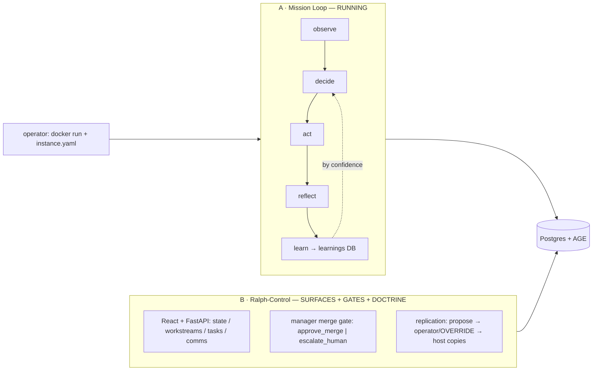
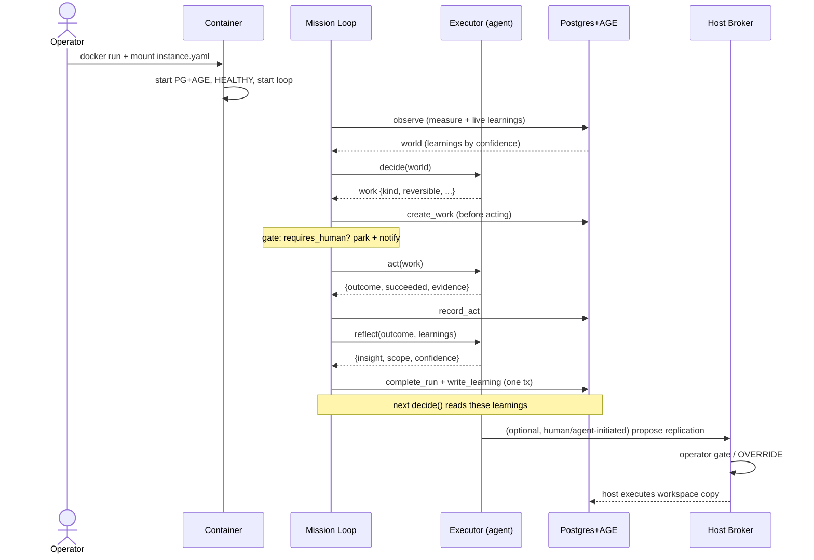

# Autonomy Quest — CURRENT state (as built in code)

**What it is today, honestly.** There are two subsystems. One **runs autonomously**; the other is
**surfaces + gates + doctrine** that a human/agent drives. Conflating them is the main way to
overstate what exists.

Diagrams (SVG in repo): `docs/checkpoints/task_4407/design/current_workflow.svg`,
`current_sequence.svg`.

## A · The mission loop — RUNNING (`runner/loop.py`)

The container's resident agent, aimed by a mounted `instance.yaml` (from the interview). It turns
forever: **observe → decide → act → reflect → learn**.

- **observe** reads the mission's measure (a ground-truth query) and **live learnings** from Postgres.
- **decide** calls the coding-agent/LLM executor with the world **including learnings ranked by
  confidence** → a work item. The decision is persisted *before* acting.
- **gate** (`requires_human`): autonomy level + mission boundaries can **park** work for a human
  before any side effect.
- **act** runs the work through the executor (which can web-search); the outcome is written down
  immediately.
- **reflect** distils an insight (scope + confidence); **complete_run + write_learning + graph_link**
  happen in one transaction. **Next cycle's `decide()` reads these learnings** — the learning loop is real.
- Guardrails: hard budget cap (stops the loop), escalation ladder, hibernation on being stuck,
  and an **artifact-or-escalate productivity check** (did it move the measure / produce evidence).

## B · Ralph-Control management — SURFACES + GATES + DOCTRINE (`management/`, `ralph_portable/`)

Delivered by the #4407 port and adversarially reviewed. These are **things you drive**, not an
autonomous orchestrator:

- **React shell + FastAPI API** over durable Postgres: `/api/ralph/state`, workstreams, tasks,
  agent-comms.
- **Manager merge gate**: `approve_merge | escalate_human` (no silent auto-merge).
- **Replication surface**: guest *proposes* (`straight_copy | copy_with_modifications`) →
  **operator-gated by default** (`AQ_REPLICATION_AUTO_APPROVE` host override) → **host executes** a
  workspace copy (guest never gets docker.sock).

## Honest "not yet" list (the gap to the desired state)

- The loop does **not** run a formal **test/validation ladder** per work item (it self-checks
  productivity, not "tests pass").
- There is **no running multi-agent orchestrator** that spawns worker cohorts, runs the ladder,
  and drives cohort→main — the manager-gated merge exists as a **gate/API**, not an autonomous flow.
- **Causal-principle analysis** and **formal planning proof** are **doctrine** (interview packs +
  design), not executable stages in the loop.
- The loop does **not autonomously request replication**; replication is an available surface.
- Replication materializes a **host-side workspace copy**; **spinning up the replica as a running
  container** is a later host step.
- The **prompt-only kit** (agent reads prompts, interviews operator, builds the system) is a
  documented, followable **contract** — not end-to-end verified the way the Docker OOTB image is.

## Workflow (mermaid mirror of the SVG)

## Sequence (mermaid mirror of the SVG)

