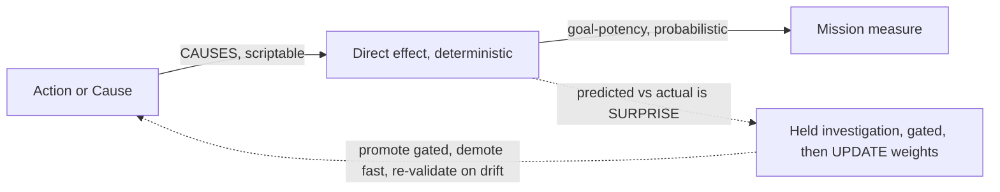
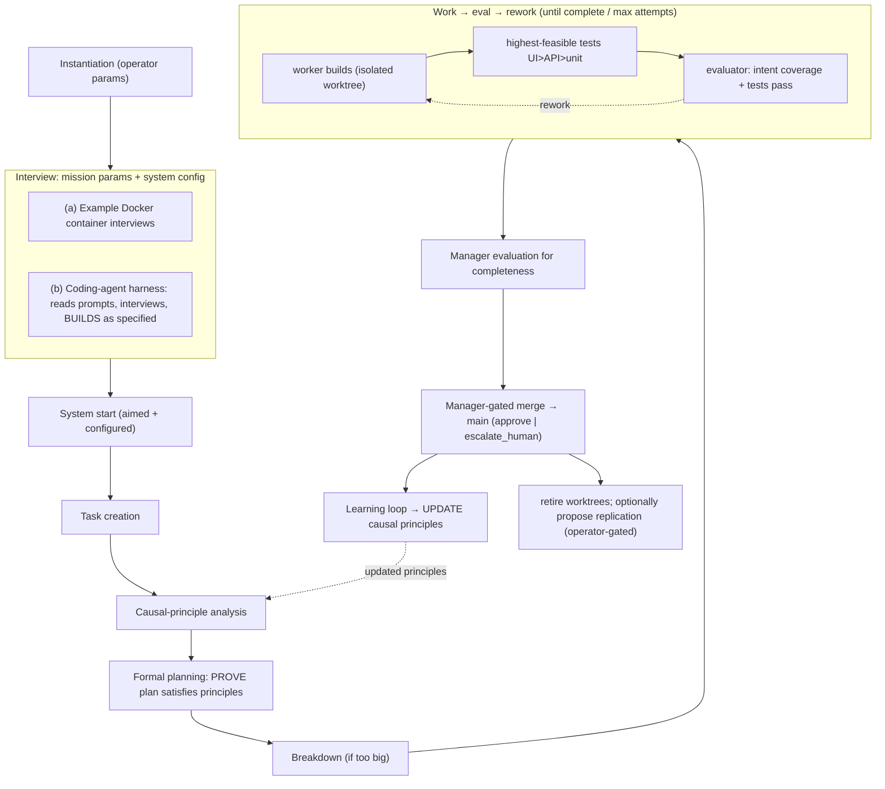
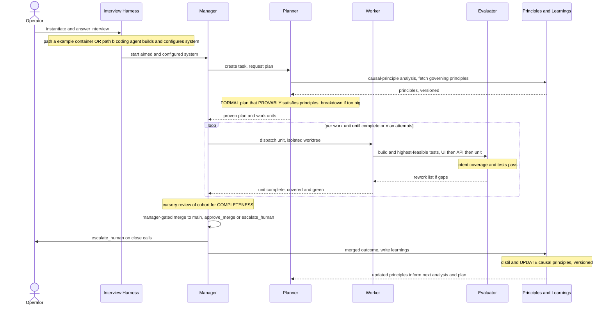

# Autonomy Quest — DESIRED state (intended workflow)

**My understanding of what you intend.** A single, coherent pipeline from **instantiation →
interview → build/configure → start → a causal-principled work loop → manager-gated merge →
a learning loop that updates the causal principles** — closing the loop so the system plans
better over time. This is the desired target; the [[current-state]] note says what exists today.

Diagrams (SVG in repo): `docs/checkpoints/task_4407/design/desired_workflow.svg`,
`desired_sequence.svg`.

## The intended pipeline, stage by stage

1. **Instantiation** — the operator provides parameters (mission + system config knobs).
2. **Interview for mission params + system config** — two entry paths, same contract:
   - **(a) Example Docker container**: the OOTB image interviews the operator for mission +
     configuration and aims itself.
   - **(b) Coding-agent harness**: an agent **reads the setup prompts**, interviews the operator,
     and **builds the system as specified by the host** (prompt-only kit; FE/BE/engines chosen at
     interview, React/FastAPI/Postgres as defaults).
3. **System start** — aimed + configured, the system begins working the mission.
4. **Task creation** — the mission (and its open questions) become concrete tasks.
5. **Causal-principle analysis** — for each task, determine which **causal principles** govern it
   (the "why this moves the goal" model), pulled from the versioned principle store.
6. **Formal planning (proof)** — produce a **formal plan that provably satisfies** those principles.
   A plan that can't be shown to satisfy the principles is rejected, not run.
7. **Breakdown** — if the plan is too big, split it into workable units.
8. **Work → eval → rework loop** (per unit, until complete or max attempts):
   - **worker builds** in an isolated worktree;
   - **highest-feasible tests** are written and run (UI > API > unit);
   - **evaluator** validates **intent coverage AND tests pass** on the worker's worktree;
   - **rework** loops until both hold, bounded by **max attempts → escalate**.
9. **Manager evaluation for completeness** — a cursory manager review of the cohort against task
   intent.
10. **Merge to main** — **manager-gated**: `approve_merge` or `escalate_human` on close calls.
11. **Learning loop → update causal principles** — the merged outcome is distilled into learnings
    that **update the causal principles** (versioned), which then **feed future analysis + planning**.
    This is the key closure: principles are not static; each completed+merged task can sharpen them.
12. **Retire** worker worktrees/sessions. Optionally, if useful to the mission, the system may
    **propose replication** (operator-gated / host-executed), with or without modifications.

## What this requires beyond today (the build list)

| Desired stage | Today | Work to close the gap |
|---|---|---|
| Interview builds/configures (path b) | prompt kit = doc contract | make the coding-agent harness drive interview→build end-to-end, verified |
| Causal-principle analysis | doctrine only | a principle store (versioned) + an analysis step wired into planning |
| Formal planning **proof** | not present | a planner that emits a plan + a checkable argument it satisfies principles |
| Breakdown | ad hoc in `decide` | explicit unit decomposition with a max-size trigger |
| Work→eval→rework with test ladder | loop does productivity check only | a worker/evaluator orchestrator that runs UI>API>unit + intent-coverage gate + rework loop |
| Manager completeness eval + gate | **gate/API exists** (`manager_merge_gate`) | wire it as the actual cohort→main step of the orchestrator |
| Learning updates **principles** | learnings feed `decide` prompts | promote learnings into principle updates (not just prompt context) |
| Replication when useful | surface exists | loop/manager logic to decide + call it; + container spin-up of the replica |

## The causal edge model (agreed with Kevin)

Authoritative visual: `causal_edge_model.svg`.

A causal claim is a graph edge decomposed into **two linked claims**:
- **action → direct effect** — mechanical; can be captured as a **deterministic script**.
- **direct effect → mission measure** — the **goal-potency**; stays **probabilistic** (the world
  is in the loop). A script GUARANTEES the action + its direct effect *in scope*; whether that
  effect moves the goal remains a weighted belief.

The edge carries **three independent weights** (three separately-queryable dials):
1. **formality / confidence** — how sure the causality is true (epistemic; grows from
   *interventional* evidence — the loop's acts are experiments).
2. **enforcement strictness** — how hard it binds behavior: advisory | soft-constraint |
   hard-guardrail (policy/deontic).
3. **directness of execution** — judgment → structured predicate → executable script/task (how
   deterministic the action is).

**Executor slot** (on the edge): primarily an **A · actuator** — runs the action deterministically,
the source of a guaranteed action. Optionally, only when warranted, **B · verifier** (checks
preconditions/effect) or **C · constraint** (forbids violating plans).

**Surprise-driven learning** (ties to `ralph_portable/surprise_resolution.py`, type
`planning_prediction_surprise`): each edge carries a **predicted certainty** for its outcome;
**actual vs predicted = surprise**; surprise raises a **held investigation** (gated, fail-closed)
that resolves into a weight update — **promotion gated, demotion fast, drift → re-validate**.
Updated weights change how the next plan is checked and executed — the causal loop closes.
Bookkeeping per edge: scope/conditions, evidence_run_ids, support_count, falsified_by, last_validated.

## Workflow (mermaid mirror of the SVG)

## Sequence (mermaid mirror of the SVG)

> Authoritative visual: `desired_sequence.svg` (renders exactly). The mermaid below is a
> render-safe text mirror — see [[mermaid-render-safe-conventions]].

